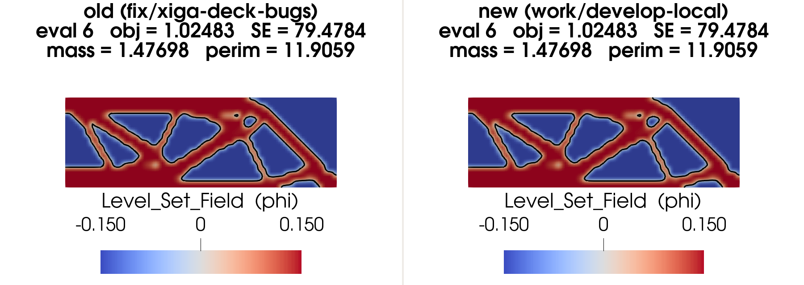
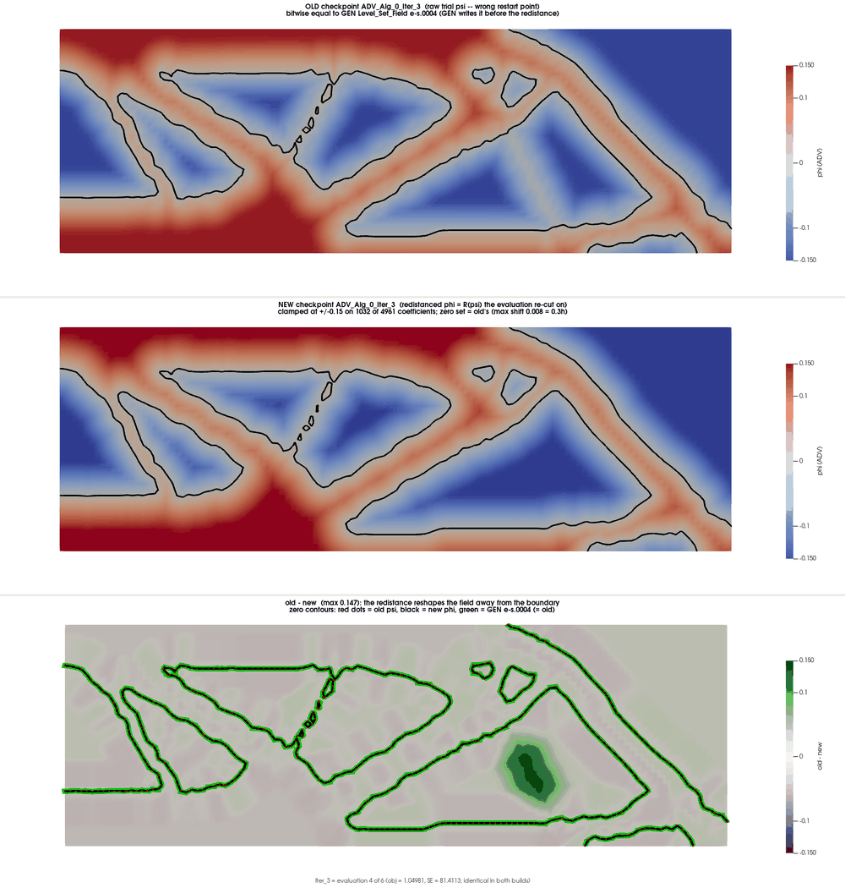

# Real-deck verification of MB-021, MB-025 and MB-026

The unit regressions for these fixes (OPT-test `[MB-021]`, `[MB-025]`, `[MB-026]`) trigger the defects on toy problems. This
record shows the same defects, and their fixes, on a production deck: the XIGA MBB level-set deck
(`studies/lunch_and_learn_xiga/decks/mbb_levelset.py` in the workspace, X9r config).

Every case ran on two builds:
- **old:** `fix/xiga-deck-bugs` @ 3bc5a1ca3, before the fixes;
- **new:** `develop` with #26 (MB-021) and #29 (MB-022..026).

Date: 2026-10-11.

## No collateral damage (5-evaluation optimization)

X9r_rcp recipe: native GCMMA, in-place SDF redistance every iteration, multilinear cut, 5 evaluations.

- **Per evaluation:** the printed objective, strain energy, mass and perimeter are identical on both builds at every evaluation (eval 6: obj 1.02483, SE 79.4784, mass 1.47698, perimeter 11.9059).
- **Exodus fields:** `Level_Set_Field` (GEN) and `UX` (VIS) differ by exactly 0.

The fixes act only in the failure, SWEEP and nested-intersection paths, so a healthy optimization is unchanged.

## MB-026: SWEEP mislabels forward/backward differences

MORIS SWEEP at the X9r start design:
- 4 interface ADVs (353, 2445, 1713, 1501);
- `finite_difference_type = all`, ε = 1e-4 and 1e-5;
- perimeter weight pinned.

The table shows `fd_forward − fd_backward` at ε₂ = 1e-5. On a smooth branch this gap keeps the sign it has at ε₁:

| ADV | old build | new build | ε₁ = 1e-4 (both builds) |
|---|---|---|---|
| 353 | −1.914e-6 ✗ | +1.914e-6 | +6.591e-7 |
| 2445 | −1.567e-6 ✗ | +1.567e-6 | +2.276e-6 |
| 1713 | −4.550e-7 ✗ | +4.550e-7 | +3.193e-6 |
| 1501 | −2.600e-6 ✗ | +2.600e-6 | +6.494e-6 |

- The new build's ε₂ `fd_forward` and `fd_backward` are the old build's values with the labels exchanged.
- The analytic gradient, the central differences and all ε₁ values are identical in both builds.
- So on the old build, every sweep with more than one epsilon or evaluation point mislabels half of its one-sided gradients.

## MB-025: single FD modes perform no differencing

The same sweep with `finite_difference_type = forward`: see the result in the PR thread (it runs after this record was written).
The expected result is no FD datasets on the old build and `fd_forward` datasets on the new one.

## MB-021: in-place SDF checkpoints hold the wrong field

The checkpoints come from the same 5-evaluation run as above. The designs are bit-identical; only the restart checkpoints
`ADV_Alg_0_Iter_k.hdf5` differ:

| k | 0 | 1 | 2 | 3 | 4 | 5 |
|---|---|---|---|---|---|---|
| max \|old − new\| | 0 | 0.101 | 0.020 | 0.147 | 0.144 | 0.040 |

- **Old:** Iter_k holds the raw trial ψ_k, bit-identical to the GEN `Level_Set_Field` (GEN writes its output before the redistance runs). The old build also writes a stray Iter_6 that equals new Iter_5.
- **New:** Iter_k holds φ_k = R(ψ_k), the redistanced design that evaluation re-cut on:
  - same sign as ψ_k at all 4961 nodes;
  - 1032 coefficients at the ±0.15 clamp (old: none);
  - |∇φ| ≈ 1 near the boundary (median 0.99 against 0.95; p10 0.84 against 0.59).
- **Why it matters:** the zero contours agree to 0.008 (0.3 h), but the field away from the boundary differs by up to 0.147. At Iter_3 the old checkpoint has a ridge only 0.0025 below zero inside a void (near x = 2.07, y = 0.40), which the redistanced design puts at −0.15. A warm restart from an old intermediate checkpoint starts one step from nucleating a strut the evaluated design does not have.

## Reproduction (workspace)

- **Runs:**
  - `runs/studies/lunch_and_learn_xiga/AB_X9r5_{old,new}`
  - `runs/studies/lunch_and_learn_xiga/DEMO_sweep_{all,forward}_{old,new}`
  - the old build is pinned with `MORISROOT_PIN`.
- **Scripts:**
  - comparison table: `runs/studies/develop_local_smoke/fix_demo/compare_sweeps.py`
  - checkpoint mapping and render: `runs/studies/lunch_and_learn_xiga/AB_X9r5_compare/visualizations/mb021_checkpoints/`
